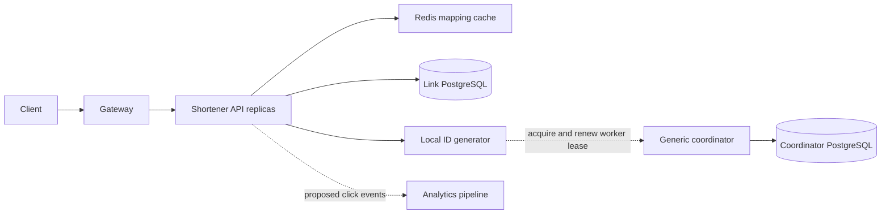

# URL shortener: a staff engineer's tutorial

Updated: 2026-10-12. **Goal:** understand the design quickly, then reason about
correctness, capacity and failure. Read section 1 first; follow the remaining
sections for the mechanics. Each checkpoint tests one essential idea.

**Evidence:** the companion `url-shortener-lab` source and coordinator/SDK source
were inspected for this guide. **Implemented** labels describe that code;
**Production extension** labels describe proposed changes. Workload numbers are
illustrative, not benchmarks. This tutorial is documentation; it adds no runtime
behavior. Companion links require the sibling repository in the same workspace.

## 1. The five-minute core

A URL shortener stores a durable mapping and returns an HTTP redirect:

```text
Create:   destination + request identity -> committed code
Resolve:  code -> destination -> 302 Location -> client visits destination
```

The service does not download the destination to redirect the client. Its hard
problems are ownership of codes, ambiguous writes, stale reads and traffic skew.

| Design question | Starting decision | Consequence |
| --- | --- | --- |
| What is authoritative? | PostgreSQL | Redis loss cannot erase a committed link. |
| Can a code change destination? | Immutable mapping; never recycle codes | Old bookmarks cannot silently acquire a new meaning. |
| What identifies a retried creation? | `(owner, requestKey)` plus the original payload | A lost response need not create another link. |
| What creates codes? | Local leased ID generator, then Base62 | Fast local generation introduces lease and clock dependencies. |
| What checks uniqueness? | Database primary key on code | Generated and custom codes share one authority. |
| What does expiry mean? | Expired at the primary clock check | This cannot retract a destination already sent to a client. |
| How are reads accelerated? | Cache immutable mappings | Finite links still require an expiry check in this lab. |

Five invariants drive the design:

1. One code has at most one committed destination across its lifetime.
2. One owner/request key has at most one committed link; changed payload conflicts.
3. Link and replay record commit together; success follows commit.
4. A cache entry cannot establish a mapping that never committed.
5. Lease failure stops new generated codes on that process; it does not erase links.

**Staff-level focus:** name the authority, atomic boundary, dependency and failure
policy for each request class before adding infrastructure.

## 2. Architecture: separate mapping from worker coordination



**Implemented:** the shortener stores links in its own database. The coordinator
stores **Product → Service → Worker Type → Worker Instance → Worker Lease**.
It allocates worker identity, not individual short codes. Acquisition locks one
slot using `FOR UPDATE SKIP LOCKED`, increments its epoch and records lease
history in one PostgreSQL transaction. Concurrent allocators can skip a locked
candidate. See [PostgreSQL locking clauses](https://www.postgresql.org/docs/current/sql-select.html#SQL-FOR-UPDATE-SHARE).

Control-plane availability and redirect availability differ. Reads never need
an ID generator. Aliases and committed retries also bypass new ID generation,
although they still need the link database.

**Production extension:** publish click events asynchronously. Decide whether
analytics is best effort or durable; a blocking broker call would add a redirect
dependency. Multiple API or coordinator processes do not remove a shared
database's failure domain.

**Checkpoint:** explain why a coordinator outage can stop generated creation
while existing redirects continue. Mistake: treating all endpoints as one SLO.

## 3. Short codes: uniqueness, length and predictability

### Encoding is separate from allocation

```text
unique integer -> repeated division by 62 -> printable code
random symbols -> candidate code -> unique database insert -> admitted code
```

Base62 has 62 symbols. A fixed length `L` offers `62^L` candidates:

```text
62^7  = 3,521,614,606,208
62^8  = 218,340,105,584,896
62^11 > maximum positive signed 64-bit integer
```

For independent uniform random codes, the expected number of colliding pairs
after `n` draws is approximately `n(n-1)/(2N)`, where `N=62^L`. At 100 million
draws and eight characters, that is about **22.9 colliding pairs**. Almost certain
to encounter a collision does not mean high per-insert collision probability:
near that occupancy, a new draw collides with probability roughly `n/N`, or
`4.58e-7`. A unique insert plus bounded retries is still necessary.

| Strategy | Mechanism and cost | Decision rule |
| --- | --- | --- |
| Database sequence + Base62 | One authority; predictable codes; sequence allocation can leave gaps | Start here when measured create load fits the database budget. |
| Uniform random Base62 | No worker coordination; collisions consume insert attempts | Prefer when removing clock/lease dependencies matters; size `L` for expected occupancy and retry budget. |
| Leased Snowflake-style ID + Base62 | Local generation; worker lifecycle and clocks become correctness concerns | Prefer when local generation has a demonstrated benefit and worker ownership is operationally supported. |
| Truncated URL hash | Same input tends to same candidate; truncation can collide | Use only with an explicit deduplication policy and collision handling. |

Different owners may want different expiry or analytics for the same destination.
Hashing the URL alone cannot express those identities. Avoid broad URL
canonicalization: query ordering and encoded paths can affect application meaning.

### The lab's ID layout

**Implemented** in [IdLayout.java](../worker-id-client/src/main/java/com/example/workeridclient/IdLayout.java):

```text
timestamp delta | region | worker | sequence
41 bits           4        10       8
epoch origin: 2024-01-01; numeric Base62 alphabet: 0-9, a-z, A-Z
```

The bit space allows 16 regions, 1,024 workers per region and 256 sequence values
per millisecond per worker. `256 × 1,000 = 256,000 IDs/s` is a representation
ceiling, not measured throughput. The 41-bit millisecond horizon is about
69.7 years from the configured origin. Codes have variable length, up to 11
characters for the supported positive signed-64-bit range.

The generator synchronizes local calls, waits on sequence overflow and stops
after local clock rollback or lease loss. The shortener adapter additionally
checks a monotonic deadline before and after generation, subtracts a two-second
safety margin and permanently fences its incarnation after renewal failure.

**Boundary:** namespace and ownership epoch are absent from the numeric ID.
Separate namespaces can produce overlapping numbers. A higher lease epoch does
not prove cross-process ID uniqueness after reassignment, restart or clock skew.
Nor does a unique code insert reject all work from an obsolete owner: it prevents
duplicate committed codes, not arbitrary stale writes. Full downstream fencing
would require the protected operation to validate ownership and reject stale work.

**Production extension:** govern layout, timestamp origin and region/worker
allocation across every producer sharing the code space. Random codes can reduce
enumerability, but public codes remain identifiers; private links require access
control and a separate entropy requirement.

**Checkpoint:** Base62 preserves an integer's uniqueness properties; it cannot
add them. Mistake: assuming the coordinator's lease epoch is encoded in the code.

## 4. Creation: one transaction resolves concurrency and retries

**Implemented API**, using a public demo identity, not authentication:

```http
POST /api/links
X-Demo-Owner: alice
Content-Type: application/json

{"requestKey":"lesson-001","url":"https://example.com/docs","ttlSeconds":300}
```

Fresh creation returns `201`; matching replay returns `200` with
`duplicate:true`. Changed URL, TTL or alias under the same owner/key returns
`409`. Missing code returns `404`; expired redirect returns `410`.

### Persist intent and result atomically

The [companion schema](../../url-shortener-lab/src/main/resources/db/migration/V1__short_links.sql)
contains two tables:

| Table | Identity | Stored state |
| --- | --- | --- |
| `creation_requests` | Primary key `(owner_id, request_key)` | Original URL, requested TTL, alias and resulting link code |
| `links` | Primary key `code`; unique `(owner_id, request_key)` | Immutable destination, creation time and optional expiry |

Codes use case-sensitive `COLLATE "C"`. Expiry is a `timestamptz`; Java uses
`Instant`. Keep the requested TTL as intent and the calculated expiry as result:
a replay must compare the original request without extending its deadline.

**Implemented** in [LinkRepository.create()](../../url-shortener-lab/src/main/java/com/example/shortener/LinkRepository.java),
with a four-second transaction timeout:

```text
BEGIN
  insert owner/key intent ON CONFLICT DO NOTHING
  lock owner/key row FOR UPDATE
  compare original payload; conflict if different
  if a link already exists: return that link
  otherwise choose alias or generate candidate
  insert link ON CONFLICT(code) DO NOTHING RETURNING ...
  attach resulting code to owner/key intent
COMMIT
return HTTP result
```

The owner/key lock serializes competing retries. The code primary key arbitrates
different requests choosing the same code. Generated collisions retry up to five
times; an occupied custom alias immediately conflicts. Exhaustion rolls back
the request and returns `503 CODE_EXHAUSTED`.

`ON CONFLICT DO NOTHING` keeps an expected code collision from aborting the
transaction; `RETURNING` distinguishes an admitted insert. A pre-insert
existence check alone races with another writer.
[PostgreSQL INSERT semantics](https://www.postgresql.org/docs/current/sql-insert.html).

### A timeout means unknown outcome

```text
API A: commit mapping -> process dies before response
Client: retry same owner/key/payload through API B
API B: lock committed intent -> return original mapping, no new ID
```

| Failure boundary | Durable state | Same-key retry |
| --- | --- | --- |
| Before commit | Neither link nor intent survives rollback | May create a link |
| After commit, before response | Both survive | Replays the original link |
| Commit acknowledgement lost | Client cannot know which occurred | Resolves outcome against the authoritative database |

This is idempotent committed creation under the stated database model. It does
not prove exactly-once HTTP delivery or preservation through an unspecified
database failover. Burned generated IDs are acceptable; overwritten links are not.

**Production extension:** authenticate owners and define request-key retention.
Removing replay records weakens old-retry semantics unless another durable
mechanism preserves them. If mappings are removed for retention or erasure,
preserve the required code reservation and define replay behavior explicitly.

**Checkpoint:** identify both serialization points: owner/key row and code
constraint. Mistake: generating a new code before checking for committed replay.

## 5. Redirects: HTTP policy and expiry are separate decisions

**Implemented:** `GET /s/{code}` returns:

```http
HTTP/1.1 302 Found
Location: https://example.com/docs
Cache-Control: no-store
```

`302` describes temporary redirection; it is not itself a universal prohibition
on caching. `no-store` instructs HTTP caches not to store this response.
`301`/`308` describe permanent moves; `307`/`308` preserve the request method.
For this GET-only route, `302` is sufficient.
[HTTP redirect semantics](https://www.rfc-editor.org/rfc/rfc9110.html#section-15.4),
[HTTP no-store](https://www.rfc-editor.org/rfc/rfc9111.html#section-5.2.2.5).

HTTP caching concerns client/gateway responses; Redis caching concerns the
service's internal mapping. They can have different policies.

```text
Redis mapping exists ----> does not imply link is still valid
DB clock >= expires_at -> 410, even if the Redis entry remains
```

**Implemented:** finite links check the primary's `clock_timestamp()`. Unlike
`now()`, which is fixed at transaction start, it observes wall time during
execution. [PostgreSQL current-time functions](https://www.postgresql.org/docs/current/functions-datetime.html#FUNCTIONS-DATETIME-CURRENT).

The precise contract is **unexpired at the database check**. A process can pause
after that check, and the network can delay delivery. The shortener also cannot
prevent use of a destination already disclosed. Choose a stronger delivery-time
contract only with an explicit timing model; no-store cannot provide it.

**Checkpoint:** distinguish business expiry, Redis TTL and HTTP freshness.
Mistake: treating cache eviction as the expiry authority.

## 6. Cache behavior: protect the database when acceleration fails

**Implemented** in [LinkService.resolve()](../../url-shortener-lab/src/main/java/com/example/shortener/LinkService.java):

```text
Redis hit + no link expiry -> redirect without database read
Redis hit + finite expiry  -> primary clock check -> redirect or 410
Redis miss/bypass          -> primary lookup -> validate expiry -> fill Redis
```

The cache stores versioned envelopes containing code, URL, expiry and an explicit
nonexpiring flag. Malformed or inconsistent envelopes fall back to PostgreSQL.
This prevents a missing expiry field from silently becoming a nonexpiring link;
it does not make Redis trustworthy against a malicious writer.

Default cache TTL is 30 seconds. Redis operations have 150 ms timeouts; errors
trigger a one-second local cooldown. Resolver database work has four concurrent
slots per API process; additional work returns `503 RESOLVER_BUSY` immediately.
The Hikari pool has eight connections; metadata and creation use other paths.
The semaphore therefore bounds resolver concurrency, not all database traffic.

```text
healthy cache -> few database lookups
cache outage -> more lookup demand -> bounded admission -> some 503s
                                      preserves recovery capacity
```

**Implemented:** missing codes are not negative-cached. A lookup before an alias
transaction commits must not hide that alias after commit.

**Production extension:** add request coalescing per key, cache TTL jitter and
bounded local caching when measured misses or hot keys justify them. Measure
total database work across replicas: doubling API count doubles the aggregate
local resolver limit. A global protection budget must follow database capacity.

**Checkpoint:** availability during cache failure depends on fallback admission,
not merely on having a fallback. Mistake: allowing every missed read to queue.

## 7. Capacity: calculate the expensive path

Assume **10 million new links/day**, **1 billion redirects/day**, a **10× peak**,
**95% cache hit rate** and **20% finite-link redirect traffic**. Decimal units;
these are planning inputs, not observed production behavior.

| Quantity | Calculation | Estimate |
| --- | --- | --- |
| Average creates | `10M / 86,400` | 116/s |
| Peak creates | `116 × 10` | 1,160/s |
| Average redirects | `1B / 86,400` | 11,574/s |
| Peak redirects | `11,574 × 10` | 115,740/s |
| New link data, assumed 500 B/link | `10M × 500 B` | 5 GB/day; 1.825 TB/year |
| Hot cache, assumed 10M entries × 300 B | `10M × 300 B` | 3 GB payload before Redis overhead |

Storage excludes replay rows, indexes, WAL, replication and backups. URL length
distribution changes the estimate. Count both permanent mappings and retained
request identities in long-term capacity planning.

Let `h` be cache hit rate and `f` the finite-link fraction **among hits**:

```text
resolver DB operations/s = redirect QPS × [(1 - h) + h × f]
                         = 115,740 × [0.05 + 0.95 × 0.20]
                         ≈ 27,778/s
```

Here, assume the hit population has the same finite fraction as traffic. Counting
only misses predicts 5,787/s and understates work by 4.8×. An expiry check is
cheaper than a mapping lookup but still consumes connections and round trips.

With mean database service time of 10 ms, Little's Law gives about
`27,778 × 0.010 = 278` concurrent operations if that rate is sustained. Four
resolver slots per API suggest an ideal ceiling near 400 operations/s per API;
real capacity must account for tail latency, headroom and database saturation.

**Decision rule:** benchmark lookup, expiry check and creation separately. Add
capacity or relax expiry semantics deliberately when the required load exceeds
the measured budget at the target p99; higher cache hit rate alone is insufficient.

**Checkpoint:** calculate query demand from request classes. Mistake: sizing from
average QPS or aggregate cache hit rate.

## 8. Scaling decisions: skew and atomicity dominate

### A viral code is one hot key

```text
hash(code) -> shard 7
viral code -> shard 7 -> shard 7 -> shard 7
```

Hash partitioning spreads many keys, not repeated requests for one key. If one
code receives 20% of peak traffic, it receives about 23,148 requests/s. Distribute
read copies using local or edge caches; coalesce misses. Finite links still impose
clock checks under the current contract. Edge freshness or local-clock expiry
would require an explicit staleness and clock-error budget.

### Two lookup keys complicate sharding

```text
resolve(code)        -> hash(code)
create(owner, key)   -> hash(owner, key)
                         potentially different authorities
```

The current creation transaction spans intent and mapping in one database.
Sharding by code can separate them, breaking that atomic boundary. A production
design must colocate state through a stable routing scheme, coordinate commits,
or introduce a recoverable admission protocol. Custom aliases also need one
global owner in the code namespace.

### Replicas and regions change contracts

**Production extension:** a lagging read replica can return `404` immediately
after successful creation. Preserve read-after-create with primary routing or a
causal replay-position mechanism, or explicitly accept bounded staleness.
Asynchronous failover can lose acknowledged mappings and replay state; define
RPO, RTO and replication policy together.

For multiple regions, global alias and retry ownership require coordination or
single-owner routing. Globally cached reads are easier than concurrent global
creation. During a partition, a region unable to reach the authoritative writer
must reject creation under the current model. Region bits in IDs do not solve
alias conflicts or retry routing.

**Decision rule:** shard when measured storage, write or uncached-read demand
exceeds a tuned primary's budget. First price the loss of the local transaction;
adding shards is also a correctness migration.

**Checkpoint:** explain how both lookup identities retain one authority during
migration. Mistake: describing a partition key without a retry-routing protocol.

## 9. Production operation: service objectives and abuse

**Production extensions**, not measured lab guarantees:

| Request class | Example objective | Signals and failure dependency |
| --- | --- | --- |
| Nonexpiring redirect | 99.95% availability; p99 < 50 ms within one region | Cache hit/miss/bypass, resolver rejection, database latency |
| Finite redirect | Same latency target; correct expiry at primary check | Primary clock checks and database availability, even on hits |
| Generated creation | 99.9% availability; p99 < 200 ms | ID state, renewal failures, transaction/lock latency, collisions |
| Alias creation / replay | Track separately | Link database and conflicts; no new generated ID required |

Define successful resolution over valid, active links; track expected `404`/`410`
separately from dependency failures. A known expired link must never redirect at
the authoritative check. Availability and expiry correctness need separate SLIs.
At 30 days, 99.95% permits 21.6 minutes of unavailability; 99.9% permits 43.2.

Page on request-class error-budget burn and saturation. Useful diagnostic signals
include p95/p99, pool wait, rejected resolver work, cache errors, generation state
and ambiguous create outcomes. HTTP health alone does not establish usable IDs.
Avoid using raw code or destination as high-cardinality metric labels.

**Implemented:** destination validation requires an absolute ASCII HTTP(S) URL,
a host, no user information and bounded length. Redirects do not fetch URLs.
**Production extension:** authenticated creation, quotas, phishing controls and
restricted metadata access. Preview/unfurl workers would fetch attacker-selected
destinations and require SSRF protection, including redirect and DNS/IP handling.
[OWASP SSRF prevention](https://cheatsheetseries.owasp.org/cheatsheets/Server_Side_Request_Forgery_Prevention_Cheat_Sheet.html).

Emergency takedown is a new policy even for immutable destinations. Define
revocation authority, propagation delay and cache invalidation before promising
it. Backups need restore drills; restored mappings and retry records must agree.

**Checkpoint:** name which path each dependency outage breaks and who owns its
recovery. Mistake: equating retained Docker volumes with database HA.

## 10. End-to-end mental model

Creation admits one mapping under database constraints. Retries recover its
identity. Resolution reads that mapping, checks validity and tells the client
where to go. Worker coordination supplies candidate IDs; caching reduces reads.

```text
owner/key -> lock intent -> alias or leased ID -> unique insert -> atomic commit
code      -> cache/database -> expiry decision -> Location -> destination client
```

### Scenario walkthroughs

These are source-derived predictions and production design exercises, not claims
that live fault experiments were executed in this documentation session.

**Normal write**

1. A validates the payload, reserves/locks owner/key and generates a candidate.
2. A commits mapping plus intent, then returns `201`.

**Normal read**

1. B checks Redis; a miss loads a committed mapping and populates the cache.
2. A later hit redirects directly if nonexpiring, or checks primary time if finite.

**One API node fails after commit**

1. The response is lost; the client retries the same request through B.
2. B reads the committed intent and returns the original code with `200`.

**Slow read replica: proposed architecture**

1. A future replica has not replayed the newly committed mapping.
2. Primary/causal routing preserves immediate visibility; unrestricted replica
   routing can produce a stale `404`.

**Network partition from link PostgreSQL**

1. The isolated API cannot commit creates, replay requests or check finite expiry.
2. Valid cached nonexpiring links can still redirect while Redis is reachable;
   database-dependent paths return bounded failures rather than inventing state.

**Node recovery**

1. Restore dependencies; verify bounded database reads and the expected ID state.
2. Restart a fenced API incarnation to acquire ownership; confirm generation and
   cross-replica replay before restoring full traffic.

**Node addition**

1. Add an API replica sharing mapping/cache authority; acquire a distinct worker
   slot for generated creation.
2. Recalculate aggregate pools and resolver admission. No mapping moves are
   needed for API scale-out; storage sharding needs a separate migration.

**Coordinator failure**

1. A failed renewal permanently fences that API's generator; initial acquisition
   failure remains waiting and can retry.
2. Redirects, available aliases and committed replays retain their independent
   paths. Restore coordination, then restart fenced replicas in stages.

## 11. Concept relationships

| Mechanism | Question it answers |
| --- | --- |
| Unique code constraint | Who may commit this code? |
| Owner/key record and lock | Is this a new intent or replay of an existing one? |
| Transaction | Which state must become visible together? |
| Base62 | How is an integer represented compactly? |
| Worker lease and epoch | Who currently owns this worker slot in the database? |
| Local lease checks | When must this process stop generating candidates? |
| Cache-aside | How can repeated mapping reads avoid the database? |
| Primary clock check | Is a finite link expired at this check? |
| Admission limit | How much fallback work can enter concurrently? |
| Shard routing | Which authority owns this lookup and its retry identity? |

## 12. Key concepts to retain

1. Uniqueness is an admission invariant; encoding is representation.
2. Lost responses require stable request identity and durable replay.
3. Cache freshness, link expiry and HTTP caching are distinct contracts.
4. Capacity follows the expensive path and the hottest key.
5. Scale-out multiplies dependency demand; sharding changes transaction boundaries.
6. Lease epochs protect coordinator ownership operations, not every downstream write.

## 13. Staff / principal drill-down

| Question | A strong answer must address |
| --- | --- |
| Why does 95% cache hit rate still imply heavy SQL traffic? | Finite-hit clock checks; compute operations by request class. |
| What if commit succeeds but acknowledgement is lost? | Unknown outcome, same-key retry, authoritative replay and failover durability. |
| Can a higher epoch prevent repeated numeric IDs? | Epoch absent from layout; namespace overlap and cross-incarnation clock assumptions. |
| What breaks when partitioning by code? | Owner/key placement, atomicity, alias authority and migration routing. |
| How would you enforce a ten-second abuse takedown? | Policy authority, cache/edge propagation and what already-issued Location permits. |
| What changes first at 10× traffic? | Measured dominant dependency, hot-key demand, admission and expiry contract. |

**Explain-back exercise:** trace one create, lost response, retry and finite
redirect. For each step, name durable state, enforcing mechanism and dependency.
Then change one assumption: Redis unavailable, delayed replica, or reassigned worker.

## 14. Source reading and references

Read code only after you can explain the flows above:

| Source | Inspect |
| --- | --- |
| [LinkRepository.java](../../url-shortener-lab/src/main/java/com/example/shortener/LinkRepository.java) | Intent lock, payload comparison, replay, collision budget and commit boundary |
| [LinkService.java](../../url-shortener-lab/src/main/java/com/example/shortener/LinkService.java), [LinkCache.java](../../url-shortener-lab/src/main/java/com/example/shortener/LinkCache.java) | Expiry checks, resolver admission and cache-envelope validation |
| [CoordinatorIds.java](../../url-shortener-lab/src/main/java/com/example/shortener/CoordinatorIds.java) | Acquisition versus renewal failure, monotonic deadline and permanent fencing |
| [PostgresWorkerCoordinator.java](../coordinator-service/src/main/java/com/example/workercoordinator/infrastructure/persistence/PostgresWorkerCoordinator.java) | Single-slot allocation, epoch/history transaction and ownership predicates |
| [LeaseAwareIdGenerator.java](../worker-id-client/src/main/java/com/example/workeridclient/LeaseAwareIdGenerator.java) | Synchronization, rollback detection and sequence overflow |
| [ShortenerIntegrationTest.java](../../url-shortener-lab/src/test/java/com/example/shortener/ShortenerIntegrationTest.java) | Concurrent same-key/alias cases, rollback, cached expiry and resolver saturation |
| [CoordinatorIdsTest.java](../../url-shortener-lab/src/test/java/com/example/shortener/CoordinatorIdsTest.java) | Renewal failure, delayed lease response and deadline checks around overflow |

The tests are executable examples; reading them does not establish production
HA, load capacity or cross-process uniqueness. For runtime exercises, use the
companion [IntelliJ guide](../../url-shortener-lab/docs/INTELLIJ_CODE_STUDY_TUTORIAL.md)
and [run guide](../../url-shortener-lab/docs/USER_GUIDE.md). Coordinator-only study
starts at [this repository's IntelliJ tutorial](INTELLIJ_CODE_STUDY_TUTORIAL.md).

External references used: [HTTP semantics, redirects](https://www.rfc-editor.org/rfc/rfc9110.html#section-15.4),
[HTTP caching, no-store](https://www.rfc-editor.org/rfc/rfc9111.html#section-5.2.2.5),
[PostgreSQL conflict handling](https://www.postgresql.org/docs/current/sql-insert.html),
[row locking](https://www.postgresql.org/docs/current/sql-select.html#SQL-FOR-UPDATE-SHARE),
[database time](https://www.postgresql.org/docs/current/functions-datetime.html#FUNCTIONS-DATETIME-CURRENT),
and [OWASP SSRF prevention](https://cheatsheetseries.owasp.org/cheatsheets/Server_Side_Request_Forgery_Prevention_Cheat_Sheet.html).
